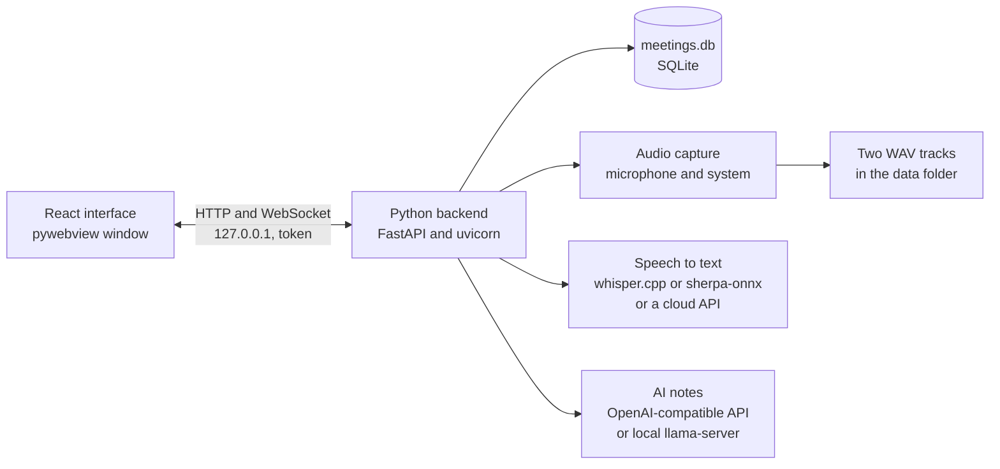

# OpenMeet

A local-first meeting notetaker for Windows 11 and Apple silicon Macs. It records your microphone and system audio, transcribes on this PC, and writes AI notes from a model you choose.

## Status

| Build | What it is |
| --- | --- |
| Windows 0.9.1 | A public `OpenMeet.exe` on the [latest release](https://github.com/rahuloruganti/OpenMeet/releases/latest). Unsigned, no installer, one file. |
| macOS 0.9.1 | Source only. You build the app yourself. |
| macOS 0.9.0 preview | An older [DMG](https://github.com/rahuloruganti/OpenMeet/releases/download/v0.9.0/OpenMeet-0.9.0-arm64.dmg). Still unqualified. |

**Not yet tested on real hardware.** Audio capture, local transcription, global shortcuts, meeting detection and the OS credential store are implemented, but have only been exercised with fakes and stubs. Builds and mocked tests do not establish recording reliability, pause behavior, transcript accuracy or summary quality. Consider it a preview, and do not rely on it as the only record of an important meeting until audio capture and transcription have been validated on real hardware.

**The Mac build has never run on a Mac.** Its code was written and unit-tested with fakes on a Windows PC. See [macOS](docs/macos.md) for what the first real run has to check.

## Install

**Quickest:** download `OpenMeet.exe` from the [latest release](https://github.com/rahuloruganti/OpenMeet/releases/latest) and run it. Check it against the SHA256 in the [release notes](docs/release-notes.md).

**Or build it yourself:**

1. Install [Node.js 24](https://nodejs.org/dist/latest-v24.x/), [uv](https://docs.astral.sh/uv/getting-started/installation/), [just](https://just.systems/man/en/packages.html) and [Git](https://git-scm.com/downloads/win). Reopen PowerShell afterwards.
2. Build the app:

```powershell
git clone https://github.com/rahuloruganti/OpenMeet.git
cd OpenMeet
just setup
just build
```

3. Run `packaging\dist\OpenMeet.exe`. Copy it anywhere you like. If SmartScreen warns, click **More info**, then **Run anyway**. Windows 11 already includes the WebView2 runtime the window needs.

## On a Mac

Apple silicon and macOS 14.2 or newer. There is no Intel build and no 0.9.1 binary.

The older [0.9.0 Mac preview](https://github.com/rahuloruganti/OpenMeet/releases/download/v0.9.0/OpenMeet-0.9.0-arm64.dmg) is the only Mac download. Build 0.9.1 from source using the steps below.

1. Build it: install Xcode command line tools (`xcode-select --install`), [uv](https://docs.astral.sh/uv/getting-started/installation/), Node.js 24 with Corepack and Git, then run `just build`. That writes `packaging/dist/OpenMeet-<version>-arm64.dmg`.
2. Open the DMG and drag **OpenMeet** to **Applications**.
3. The build is unsigned and not notarized, so the first open is a right-click, **Open**, **Open** again. To skip that step: `xattr -dr com.apple.quarantine /Applications/OpenMeet.app`.

Allow Microphone and System Audio Recording when macOS asks. [macOS notes](docs/macos.md) covers permissions, data location, shortcuts and what is still untested.

## Set up

The first launch opens **Set up OpenMeet**:

1. Import an earlier data folder, if one is found. A Mac never has one, so the step does not appear there.
2. Pick transcription: a speech model on this PC, a local speech server, or an online API.
3. Pick AI notes (optional): an online API connection, or **Settings → AI notes → Local AI** to run a model on this PC.
4. Pick your default microphone and output device.

API keys go to the OS credential store (Windows Credential Manager, or Keychain on macOS) and are never shown again. You can change everything later in **Settings**. Nothing downloads until you click.

Your data lives in `%APPDATA%\OpenMeetPy\` on Windows and `~/Library/Application Support/OpenMeetPy/` on a Mac, unencrypted. There is no telemetry. See [privacy](docs/privacy.md).

## How it fits together

The app is one Python backend and one React interface, packaged together as the `.exe` or the `.app`:



The backend serves on a random loopback port and requires a per-run token for API commands, file reads and the event WebSocket; the health check, the page itself and its static assets are served without one. The window opens `http://127.0.0.1:<port>/`, and the server serves the built UI from the app bundle. Recordings are written to the data folder, and cloud calls happen only for the actions you configure. The [privacy page](docs/privacy.md) lists every network action.

## Develop

```powershell
just dev     # run from source
just check   # typecheck, lint, format, tests, build
```

On a Mac the same recipes run in bash: `just dev` for a source run and `just check` for the full set.

See the [docs](docs/README.md) and [dependencies](docs/dependencies.md).

## License

MIT. See [LICENSE](LICENSE) and [third-party licenses](THIRD_PARTY_LICENSES.md).
