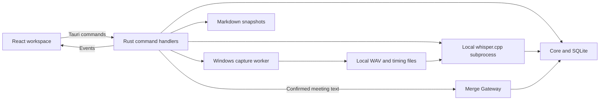

# OpenMeet architecture

OpenMeet runs a React interface inside a Tauri 2 desktop app. Rust owns the database, audio capture, model files, transcription subprocess, network requests, and credentials. React renders state and issues typed commands.

## Runtime flow

Model downloads are separate explicit network actions. Audio is not sent to Merge. The diagram describes the implementation; it does not establish hardware or provider qualification.

## Code ownership

| File or directory                       | Responsibility                                                                                          |
| --------------------------------------- | ------------------------------------------------------------------------------------------------------- |
| `src/App.tsx`                           | Selection, settings/setup panels, command orchestration, operation guards, and note lifecycle.          |
| `src/components/MeetingSidebar.tsx`     | Meeting library, source labels, title and content search.                                               |
| `src/components/MeetingWorkspace.tsx`   | Notes, transcript, playback, summaries, questions, export, and deletion confirmations.                  |
| `src/components/SetupPanel.tsx`         | Device selection, capture consent, and separate simulation entry.                                       |
| `src/components/SettingsPanel.tsx`      | Speech settings/downloads, Merge setup, shortcuts, and export preferences.                              |
| `src/components/RecordingControls.tsx`  | Backend capture state, pause/resume/stop, and audio meters.                                             |
| `src/lib/api.ts`                        | TypeScript command bindings, response types, events, and asset URLs.                                    |
| `src/lib/note-writer.ts`                | Debounced and serialized note writes with flush and error handling.                                     |
| `src/lib/markdown.tsx`, `timestamps.ts` | Supported Markdown rendering and timestamp parsing.                                                     |
| `src-tauri/src/lib.rs`                  | Tauri handlers, shared state, worker dispatch, events, tray, shortcuts, and graceful exit.              |
| `src-tauri/src/domain.rs`               | Rust payloads, settings, recording state, and error codes.                                              |
| `src-tauri/src/storage.rs`              | `Core`, SQLite migrations, persistence, search, capture lifecycle, deletion, and recovery metadata.     |
| `src-tauri/src/audio.rs`                | Device enumeration, bounded sample queues, capture worker, WAV writers, timing indexes, and WAV repair. |
| `src-tauri/src/stt.rs`                  | Pinned artifact downloads, local engine execution, progress/cancel, and time mapping.                   |
| `src-tauri/src/merge.rs`                | Keychain access, model discovery, prompts, input limits, summaries, and meeting questions.              |
| `src-tauri/src/export.rs`               | Markdown rendering, safe filenames, and non-overwriting publication.                                    |
| `src-tauri/migrations/`                 | Ordered SQLite upgrades through schema v9.                                                              |
| `fixtures/`                             | Fictional content used for tests and the sample meeting.                                                |

## State and concurrency

`AppState` owns a mutex-protected `Core`. `with_core` runs database and lifecycle operations on a blocking worker. Other blocking operations, such as inference and HTTP requests, also run outside the webview thread.

The backend's `RecordingState` contains a monotonically increasing revision, status, meeting ID, source, error, and optional audio-derived offset. The frontend uses revisions to avoid replacing newer state with an older response. Commands return authoritative state; events notify the frontend to refresh.

Capture status is `idle`, `recording`, `paused`, or `stopped`. A persisted meeting can also be `interrupted`. Its source is independently `note`, `desktop`, `simulation`, or `fixture`. A stopped fixture is not evidence of completed capture.

There is one active capture. The transcription module also uses a process-wide lock and cancellation flag. Frontend guards prevent overlapping UI jobs, but there is no durable processing-job queue. A restart does not resume an inference request.

## Notes and close behavior

`createNoteWriter` debounces edits for 400 ms and serializes saves. The database updates notes only when the supplied revision matches the saved revision. A stale write fails instead of replacing newer text.

Meeting switches, exports, and graceful close flush notes. A failed flush preserves the draft and prevents graceful quit. Stop requests capture shutdown before waiting for note saving, so a save failure does not keep recording intentionally active.

## Capture and transcription

Windows capture opens the explicitly selected microphone and system output. Callbacks enqueue samples into bounded buffers. A worker writes separate native-rate WAV files and timing JSONL. Pause generations reject queued samples from an earlier recording interval. Queue overflow and device failures are visible errors, not a fallback to one track.

Control acknowledgements and real-device timing remain stabilization work. Synthetic pause tests do not qualify hardware pause privacy. Silent WASAPI loopback may deliver no frames.

Transcription runs the downloaded Windows x64 CPU build of whisper.cpp with the selected Whisper model, Silero VAD, language, and vocabulary hint. Finalized tracks are processed locally. JSON results become `You` and `Others` segments; the timing index maps file positions onto the session timeline. A successful run replaces prior Whisper segments. Failure or cancellation preserves the previous transcript and notes.

## Merge requests

The current adapter uses `https://api-gateway.merge.dev/v1/models` for model discovery and `https://api-gateway.merge.dev/v1/chat/completions` for summaries and questions. These are the routes in `merge.rs`; older plans mention a different OpenAI-compatible route.

The API key is explicitly imported from `OPENMEET_LLM_API_KEY` into the OS keychain. React receives key status, never the key value. Model discovery is user-triggered and carries no meeting text. The model selection must be present in the available catalog before saving.

The summary planner chooses a single request or transcript chunks followed by a combination request. The backend checks consent and that the required request count still matches the confirmed count. Oversized inputs are refused. Summary versions persist with provider, model, and versioned template ID. Questions use only the selected meeting and return an answer without persisting it.

## Storage and migrations

| Table            | Contents                                                                         |
| ---------------- | -------------------------------------------------------------------------------- |
| `meetings`       | Title, source, timestamps, persisted status, and capture error.                  |
| `notes`          | User Markdown and optimistic revision.                                           |
| `tracks`         | Paths, audio format, frame counts, dropped frames, and finalization.             |
| `segments`       | Track label, times, text, source, and final pass.                                |
| `summaries`      | Retained versions with provider, model, and template ID.                         |
| `settings`       | Devices, shortcuts, speech configuration, Merge model, and export choices.       |
| `search`         | FTS5 copies of titles, notes, transcript text, and summaries.                    |
| `capture_events` | Historical schema table; current capture no longer writes lifecycle events here. |

`Core::open` enables WAL and applies numbered migrations using `PRAGMA user_version`. Table rebuilds that need foreign keys disabled perform a foreign-key check before committing. Existing user databases must be upgraded, never reset to repair a development problem. Older `local_model` settings remain in the schema but are unused.

Search triggers maintain the FTS5 index as notes, segments, titles, and summaries change. Audio and models are separate files, not database blobs. See [privacy](privacy.md) for paths and backup boundaries.

## IPC and permissions

The complete command signatures are in [api.ts](../src/lib/api.ts), with matching handlers registered in [lib.rs](../src-tauri/src/lib.rs). Keep nested field names and nullability consistent with [domain.rs](../src-tauri/src/domain.rs).

| Event             | Purpose                                   |
| ----------------- | ----------------------------------------- |
| `recording_state` | Capture-state notification with revision. |
| `meeting_updated` | Refresh persisted library or detail data. |
| `audio_health`    | Capture metrics and level-meter input.    |
| `stt_progress`    | Model download or transcription progress. |
| `backend_error`   | Visible backend failure message.          |
| `request_close`   | Request note flush before backend exit.   |

[The capability file](../src-tauri/capabilities/main.json) permits event subscriptions. Native filesystem, dialog, shortcut, and exit operations remain Rust commands. [Tauri configuration](../src-tauri/tauri.conf.json) restricts playback assets to the app-data audio folder and limits network access from the webview. This is an implementation boundary, not a completed security audit.

Exports use temporary files in the selected destination, path validation, and non-clobbering publication. The `%%ai-start%%` markers delimit summary text in a snapshot; they do not implement merging with external edits.
