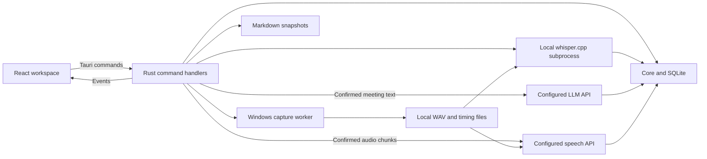

# OpenMeet architecture

OpenMeet runs a React interface inside a Tauri 2 desktop app. Rust owns the database, audio capture, model files, transcription subprocess, network requests, and credentials. React renders state and issues typed commands.

## Runtime flow

Model downloads are separate explicit network actions. Cloud transcription uploads audio only after its own confirmation; local Whisper remains the default. Summary/question calls send text only. The diagram does not establish hardware or provider qualification.

## Code ownership

| File or directory                                          | Responsibility                                                                                          |
| ---------------------------------------------------------- | ------------------------------------------------------------------------------------------------------- |
| `src/App.tsx`                                              | Selection, settings/setup panels, command orchestration, operation guards, and note lifecycle.          |
| `src/components/MeetingSidebar.tsx`                        | Meeting library, source labels, title and content search.                                               |
| `src/components/MeetingWorkspace.tsx`                      | Notes, transcript, playback, summaries, questions, export, and deletion confirmations.                  |
| `src/components/SetupPanel.tsx`                            | Device selection and capture consent.                                                                   |
| `src/components/SettingsPanel.tsx`, `ProviderSettings.tsx` | Independent provider/key/model setup, speech mode/downloads, shortcuts, and export preferences.         |
| `src/components/RecordingControls.tsx`                     | Backend capture state, pause/resume/stop, and audio meters.                                             |
| `src/lib/api.ts`                                           | TypeScript command bindings, response types, events, and asset URLs.                                    |
| `src/lib/note-writer.ts`                                   | Debounced and serialized note writes with flush and error handling.                                     |
| `src/lib/markdown.tsx`, `timestamps.ts`                    | Supported Markdown rendering and timestamp parsing.                                                     |
| `src-tauri/src/lib.rs`                                     | Tauri handlers, shared state, worker dispatch, events, tray, shortcuts, and graceful exit.              |
| `src-tauri/src/domain.rs`                                  | Rust payloads, settings, recording state, and error codes.                                              |
| `src-tauri/src/storage.rs`                                 | `Core`, SQLite migrations, persistence, search, capture lifecycle, deletion, and recovery metadata.     |
| `src-tauri/src/audio.rs`                                   | Device enumeration, bounded sample queues, capture worker, WAV writers, timing indexes, and WAV repair. |
| `src-tauri/src/stt.rs`                                     | Pinned artifact downloads, local engine execution, progress/cancel, and time mapping.                   |
| `src-tauri/src/providers.rs`                               | URL/model validation, keychain access, frozen credentials, model discovery, and bounded HTTP.           |
| `src-tauri/src/llm.rs`                                     | Summary/question prompts, input limits, and chunked text requests.                                      |
| `src-tauri/src/cloud_stt.rs`                               | Frozen bounded WAV preparation, pause-aware chunks, multipart uploads, and timed/untimed parsing.       |
| `src-tauri/src/export.rs`                                  | Markdown rendering, safe filenames, and non-overwriting publication.                                    |
| `src-tauri/migrations/`                                    | Ordered SQLite upgrades through schema v11.                                                             |
| `fixtures/`                                                | Fictional test resources, excluded from production creation paths.                                      |

## State and concurrency

`AppState` owns a mutex-protected `Core`. `with_core` runs database and lifecycle operations on a blocking worker. Other blocking operations, such as inference and HTTP requests, also run outside the webview thread.

The backend's `RecordingState` contains a monotonically increasing revision, status, meeting ID, source, error, and optional audio-derived offset. The frontend uses revisions to avoid replacing newer state with an older response. Commands return authoritative state; events notify the frontend to refresh.

Capture status is `idle`, `recording`, `paused`, or `stopped`. A persisted meeting can also be `interrupted`. New meetings are `note` or `desktop`; legacy `simulation` and `fixture` sources stay readable and honestly labeled. Their creation commands and production fixture loading are removed.

There is one active capture. The transcription module also uses a process-wide lock and cancellation flag. Frontend guards prevent overlapping UI jobs, but there is no durable processing-job queue. A restart does not resume an inference request.

## Notes and close behavior

`createNoteWriter` debounces edits for 400 ms and serializes saves. The database updates notes only when the supplied revision matches the saved revision. A stale write fails instead of replacing newer text.

Meeting switches, exports, and graceful close flush notes. A failed flush preserves the draft and prevents graceful quit. Stop requests capture shutdown before waiting for note saving, so a save failure does not keep recording intentionally active.

## Capture and transcription

Windows capture opens the explicitly selected microphone and system output. Callbacks enqueue samples into bounded buffers. A worker writes separate native-rate WAV files and timing JSONL. Pause generations reject queued samples from an earlier recording interval. Queue overflow and device failures are visible errors, not a fallback to one track.

Control acknowledgements and real-device timing remain stabilization work. Synthetic pause tests do not qualify hardware pause privacy. Silent WASAPI loopback may deliver no frames.

Local transcription runs the downloaded Windows x64 CPU build of whisper.cpp with the selected model, Silero VAD, language, and vocabulary hint. Cloud mode independently selects a compatible endpoint/key/model and uploads frozen PCM16 WAV chunks after confirmation. Chunk boundaries respect pause generations and timing discontinuities. Both modes preserve `You` and `Others` track labels.

The `audio_timing` module validates bounded timing indexes for local transcription, cloud preparation, and mapped seeking. Local processing rejects incomplete timing before engine setup. Segment starts and ends map to opposite sides of a pause boundary, so a pre-pause segment does not extend through the gap. Damaged indexes produce visible errors instead of file-time guesses.

The transcription run guard covers preparation, processing, and publication. Cancellation and final publication share a gate. A successful transaction replaces prior local/cloud generated segments and stores provider/model provenance, including successful empty results. Failure/cancellation preserves the previous transcript and notes. Valid timestamps map through the original timing index. JSON text without timestamps is explicitly untimed, grouped by track, and has no seek link or fabricated time citation.

## Provider requests

The Phase 3 `session_processing` module adds backend-only preparation for future session consent. A review specifies live-only or final transcription, optional live text and summary, independent destinations, two-track scope, and declared limits. Its fingerprint identifies a single in-memory review that expires after five minutes. Recording start can consume that review and attach its plan in the same SQLite transaction as the new recording. Participant consent remains separate. The normal UI starts recording without a session plan.

Schema 13 stores attached plans and revisioned prepared, consent-required, cancelled, or interrupted state. Speech settings and provider edits advance a configuration revision and invalidate prepared consent, including edit-and-revert and credential replacement. Invalidation conservatively includes changes to unselected saved connections and their names. Unchanged speech settings and shortcut/export changes do not invalidate it. Startup marks prepared records interrupted once, and snapshot reads require renewed consent after the one-hour authorization window or a backwards clock jump before the stored start. Cancellation is idempotent and leaves recording and saved content alone.

This increment does not dispatch jobs, enforce upload/request/text budgets against actual requests, or expose processing choices in the UI. The existing manual actions and guards remain authoritative. Payload freezing, a shared processing owner, a live worker, automatic final processing, and their UI remain Phase 3 work. See [the execution plan](phase-3-execution-plan.md).

Reusable saved connections supply independent summary/question and speech task assignments. Each assignment keeps its own model ID and revision; changing a shared connection invalidates consent for every role using it. Assigned connections cannot be deleted. Rust appends `models`, `chat/completions`, or `audio/transcriptions` to a validated user-supplied HTTPS API base, preserving its path prefix. Redirects are disabled. Credentials and response bodies do not enter diagnostics. Local servers may use loopback HTTP with an optional key. Remote endpoints require HTTPS and a destination-bound key.

Settings submits a transient password input through IPC to the OS keychain. Read responses contain key status only. Saving connection/model settings makes no network request; explicit refresh fetches generic `data[].id` model lists. Custom IDs work without discovery or catalog membership. A model list proves neither chat nor audio capability. Legacy Merge configuration is not automatically activated or converted.

The summary planner chooses a single request or transcript chunks followed by a combination request. Consent binds configuration revision/destination, model, exact content, action/template/question, and request plan. Oversized inputs are refused. Summary versions persist with destination, model, and template ID. Questions use only the selected meeting and return an answer without persisting it. Cloud audio plans additionally bind frozen chunk content/timing hashes. No automatic uploads, provider fallback, or billable retries are performed.

The Rust `model_library` module owns bounded scans, verified catalog imports, public Hugging Face metadata, pinned downloads, and provenance manifests. It shares an artifact-operation guard and cancellation/publication gate with the existing speech installer. Discovery does not activate a model or start inference. `model_library_progress` reports transfer bytes. See [Phase 2 verification](phase-2-settings-verification.md) for limits.

## Storage and migrations

| Table                      | Contents                                                                              |
| -------------------------- | ------------------------------------------------------------------------------------- |
| `meetings`                 | Title, source, timestamps, persisted status, and capture error.                       |
| `notes`                    | User Markdown and optimistic revision.                                                |
| `tracks`                   | Paths, audio format, frame counts, dropped frames, and finalization.                  |
| `segments`                 | Track label, paired nullable times, text, source, and final pass.                     |
| `summaries`                | Retained versions with provider, model, and template ID.                              |
| `settings`                 | Devices, shortcuts, local model/language/vocabulary, speech mode, and export choices. |
| `saved_connections`        | Named nonsecret endpoint/revision and OS-keychain account reference.                  |
| `provider_assignments`     | Independent task connection/model selection and monotonic revision.                   |
| `processing_configuration` | Revision invalidating session reviews after speech/provider edits.                    |
| `processing_sessions`      | Recording-bound consent plan, deadlines, state, and revision.                         |
| `meeting_transcriptions`   | Last successful provider/model provenance per meeting.                                |
| `search`                   | FTS5 copies of titles, notes, transcript text, and summaries.                         |
| `capture_events`           | Historical schema table; current capture no longer writes lifecycle events here.      |

`Core::open` enables WAL and applies numbered migrations using `PRAGMA user_version`. Table rebuilds that need foreign keys disabled perform a foreign-key check before committing. Migration 011 preserves segment IDs and restores FTS triggers while adding cloud/untimed entries. Migration 012 copies existing provider profiles and credential references into saved connections and assignments without reading secrets. Populated upgrade tests cover notes, transcripts, search, and foreign keys. Existing user databases are upgraded without resetting them. Legacy `local_model`/`merge_model` columns remain unused.

Search triggers maintain the FTS5 index as notes, segments, titles, and summaries change. Recovery attempts publish to fresh recovered-copy filenames so a failed database update does not block retry or overwrite an earlier copy. Audio and models are separate files, not database blobs. See [privacy](privacy.md) for paths and backup boundaries.

## IPC and permissions

The complete command signatures are in [api.ts](../src/lib/api.ts), with matching handlers registered in [lib.rs](../src-tauri/src/lib.rs). Keep nested field names and nullability consistent with [domain.rs](../src-tauri/src/domain.rs).

| Event             | Purpose                                   |
| ----------------- | ----------------------------------------- |
| `recording_state` | Capture-state notification with revision. |
| `meeting_updated` | Refresh persisted library or detail data. |
| `audio_health`    | Capture metrics and level-meter input.    |
| `stt_progress`    | Model download or transcription progress. |
| `backend_error`   | Visible backend failure message.          |
| `request_close`   | Request note flush before backend exit.   |

[The capability file](../src-tauri/capabilities/main.json) permits event subscriptions. Native filesystem, dialog, shortcut, and exit operations remain Rust commands. [Tauri configuration](../src-tauri/tauri.conf.json) restricts playback assets to the app-data audio folder and limits network access from the webview. This is an implementation boundary, not a completed security audit.

Exports use temporary files in the selected destination, path validation, and non-clobbering publication. The `%%ai-start%%` markers delimit summary text in a snapshot; they do not implement merging with external edits.
