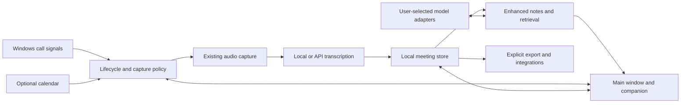
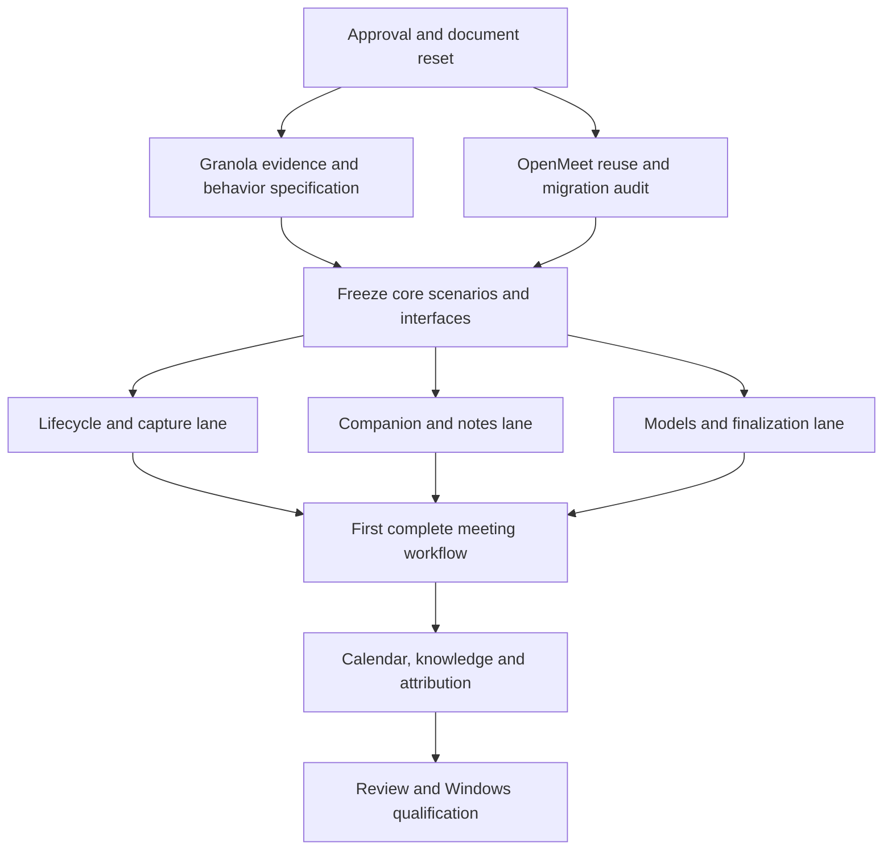

# OpenMeet: Granola-informed reset

**Review plan | 2026-10-26 | Awaiting approval**

Baseline: OpenMeet `7837e295d7e9ca0322be2d8b0c916b68a9249449`; installed Windows Granola `7.668.3`.
Confirmed: plan-first approval; document reset with safety/license guidance retained; Settings/empty UI inspection only; opt-in meeting auto-capture/end with visible status.

## Summary
Build an original local-first Granola alternative: recognize meetings, transcribe after automation is enabled, provide compact notes/chat, recognize the end and enhance rough notes from the transcript. Add calendar context, organization and export in stages. Reuse sound OpenMeet code; old roadmaps are not requirements.

Granola's help normally requires opening a note/clicking a notification to start. Fully automatic opt-in capture is our extension, not proven Granola parity.

REA parsed five selected JS modules and the manifest without execution: inactivity warning/deadline, final-session wait, calendar-policy categories and mini-window preview bridge. Runtime availability and full algorithms remain unverified. Native-file/archive hash mismatches remain unresolved. UI observation reached Home; background navigation failed, leaving Settings/compact behavior unobserved.

## What you will get
Evidence-linked feature inventory; opt-in automatic meeting lifecycle; floating indicator and compact notes/chat; separate raw and enhanced notes with source links; independent local/API model choices; calendar context, scoped knowledge and exports. Old planning documents no longer govern development.

## What will be built

| Part | Responsibility | Size | Built by |
|---|---|---|---|
| Evidence | Reproducible Granola scenarios and OpenMeet gap map. | L | Research helpers; parent verifies |
| Lifecycle | Call signals, policy and authoritative session state. | L | Careful Windows/concurrency helper |
| Companion | Compact status, notes, transcript and chat. | L | Careful interface helper |
| Models/finalization | Explicit routing, budgets and final-result draining. | M | Careful audio/provider helper |
| Enhanced notes | Versioned, source-linked output preserving rough notes. | M | Careful notes helper |
| Calendar/preparation | Read-only calendars, linking and prior context. | L | Careful integration helper |
| Knowledge | Folders, scoped retrieval/chat and reusable prompts. | L | Careful search/storage helpers |
| Attribution | Supported speaker signals with unknown fallback. | L | Careful Windows helper |
| Portability | Export and scoped API/MCP before external connectors. | M/L | Integration/security helpers |
| Qualification | Privacy/races, upgrades, packaging and Windows trials. | L | Independent reviewers and parent |

Reuse capture, pause generations, live transcription, revisioned notes, summaries, templates, model connections, migrations and export. Detection currently emits mic-use changes only; the app has one main window; library chat requires selected meetings. Calendar/folders were absent in the bounded audit. These are code findings, not hardware qualification. Keep React/Python/pywebview unless focused experiments demonstrate a blocker.

## How it fits together

Detection reports signals but cannot record. The lifecycle controller owns session transitions. All windows use one backend and revisioned saves. Model operations use immutable configuration snapshots. Enhancement waits for final transcript persistence. User notes, transcript and AI output stay distinct. Granola's private endpoints are never a dependency.

Lifecycle: **Disabled → Armed → Candidate → Recording → End pending → Finalizing → Complete**, with **Paused** and **Recoverable error** paths. Transitions record reasons/session IDs, not conversation content. Duplicate signals cannot create duplicate meetings. Manual pause/stop wins and suppresses reactivation until a genuinely new meeting.

## How it gets built

### 0. Retire the old specification

Execute Appendix A after approval; update broken links and superseded product rules. Preserve the Git baseline and back up untracked design documents outside the active project before deleting working copies. Never reset meeting databases, erase audio/notes, delete tests or rewrite Git history. Prior mockups cease to be requirements; historical test/review records remain evidence only.

### 1. Reverse engineer the behaviors
Pin package/version/hashes and inventory main/preload/renderer modules and native bridges. Resolve native integrity discrepancies before trusting affected files. Trace detection/end evaluation, capture, compact windows, enhancement, chat scope, templates and calendar linking using REA selected-source analysis. Analyze native code only for unresolved Windows signal semantics.

For each feature record trigger, preconditions, transitions, UI/data effects, failures, platform, evidence and unknowns. Strings/filenames are leads, not proof. Observe only Settings/empty UI; foreground navigation needs permission after the background refusal. No fuse changes or protection bypass.

With separate recording/upload permission, test fictional scheduled/ad-hoc calls, mute, reconnect, mic release, overrun, back-to-back calls, device loss and sleep. Disclose Granola's possible test-audio uploads first. Give implementers behavior-only specifications, never extracted code/assets/prompts; keep raw artifacts out of public Git.

**Gate:** Core scenarios have evidence or labelled OpenMeet design decisions. Unknown timing/feature availability remains unknown. Material scope changes return for approval.

### 2. Deliver the first usable end-to-end workflow
**Enable → detect supported call → visible capture/live transcript → companion notes → recognize end → drain finals → enhance.**

Start with desktop call apps validated in Windows trials. Browser mic use or an idle Teams process is insufficient; ambiguous cases prompt. Combine call-presence and capture signals with debounce/grace; silence and calendar end alone cannot prove completion. Offer **Keep recording**, **End now** and manual split. Set timings from trials, labelled as our choices where not observed in Granola.

Implement lifecycle, companion and provider/finalization lanes in parallel against contracts. Quick notes never silently activate capture. Pause stops audio/transcription; companion close preserves drafts and does not unexpectedly end a call.

### 3. Add context and knowledge parity
Add optional read-only Google/Microsoft calendars, recurrence/timezone handling, linking, reminders and related-meeting preparation; retain no-calendar operation. Add source-linked enhancements, templates and safe rewrites. Add folders and scoped retrieval/chat, starting with FTS and evaluating optional local embeddings. Live chat uses persisted finals and labels incomplete context. Research speaker tags separately from diarization; never invent participant names.

### 4. Complete portability and qualify
Add copy/export and permission-scoped local API/MCP. Inventory file context, People/Companies, preparation, recipes, sharing and integrations rather than silently omit major categories. External connections/publication need authorization; hosted sharing/sync needs a separate security design. Finish independent review, packaging, populated-data upgrades and permissioned Windows trials. Do not claim full parity or qualification prematurely.

## Decisions you can change
- Windows first; retain the current stack unless a focused experiment proves a blocker.
- Automation off until enabled; supported high-confidence calls auto-start, uncertain cases prompt. No ambient listening.
- Interpret side notes as a floating indicator plus compact editor; confirm the exact Granola surface in UI observation.
- Keep existing audio/notes and current retention. Temporary-audio mode needs a later explicit choice and recovery tests, never silent deletion.
- Choose transcription, enhancement/chat and embeddings independently; no silent cloud fallback.
- Original OpenMeet branding/assets and MIT license; old console styling is not binding. Check model redistribution licenses.
- Approval authorizes scoped development, not recording/uploads, push/release or material scope expansion.

## Risks
False detection: corroborate signals, exclude our own mic and prompt on ambiguity. Premature end/merged calls: test mute, reconnect and handoff; allow cancellation/splitting. Privacy/billing: disclose system-wide capture, prevent hidden uploads/retry, and preserve participant-consent responsibility. Data loss: one backend, revisioned saves, exactly-once finalization and recoverable failures. AI mistakes: validate source IDs and retain raw notes/undo. Evidence disagreements: version findings and preserve uncertainty. Proprietary contamination: independent implementation, no copied assets or private API dependency.

## Out of scope

No account/paywall bypass, credential/private-note extraction, fuse changes, unsolicited recording, ambient surveillance, blanket rewrite or automatic publication. Mobile clients, enterprise SSO/admin parity and hosted collaboration are separate projects, not Windows-core completion criteria. Track these as deferred in the parity ledger rather than imply they are implemented.

## How we will know it works
1. Disabled mode opens no capture streams. Supported calls create one session; duplicate signals, dictation, playback and our own mic cause no false starts in negative fixtures.
2. Mute/quiet/reconnect does not prematurely finalize ongoing calls. End is explainable and cancellable; manual stop/pause suppresses restart for that call.
3. Back-to-back calls retain distinct identities and final segments; late results cannot enter the next meeting.
4. Main/companion share revisions; concurrent edits, close and failed saves preserve drafts. Indicators match actual capture.
5. Pause blocks queued/new audio persistence and transmission. Failures cause no hidden retry/fallback or stale-config publication.
6. Local mode works offline after model setup. API mode honors selected endpoint and budgets.
7. Enhancement retains rough notes/provenance and valid sources. Retrieval respects scope and deleted content. Calendar tests cover recurrence/timezones/cancellation/overlap; unknown speakers stay unknown.
8. Preserve existing tests; add regressions first. Run suites, type/lint/format, package, smoke, populated-data upgrade and close checks.
9. Permissioned synthetic Windows trials measure detection precision, start/end latency, transcript lag, memory growth and note faithfulness. Record supported apps/devices and failures; mocks do not qualify hardware.

## Rough time and cost
Unmeasured planning ranges: RE/spec 1–3 working days; core workflow 3–7 more days; broader parity 2–6 further weeks. Re-estimate after discovery. API costs need an agreed provider/test-duration/spend cap. No paid inference or downloads authorized.

## Appendix A: document reset manifest

Delete after approval, not the whole docs directory:

- `PRODUCT.md`
- `docs/architecture.md`
- `docs/user-guide.md`
- `docs/implementation-status.md`
- `docs/rebuild-status.md`
- `docs/release-notes-0.9.0.md`
- `docs/v1-release-plan.md`
- `docs/archive/Open-source meeting notetaker development plan and tool inventory.md`
- `docs/archive/foundation-qualification-follow-up.md`
- `docs/archive/phase-1-foundation-verification.md`
- `docs/archive/phase-1-implementation-plan.md`
- `docs/archive/phase-2-settings-verification.md`
- `docs/archive/phase-3-execution-plan.md`
- `docs/archive/phase-3-workflow-verification.md`
- `.impeccable/settings-brief.md`
- `.impeccable/surfaces/src-widgets-settings-panel-settingspanel-tsx.md`
- `.impeccable/critique/2026-10-24T20-03-06Z__src-widgets-settings-panel-settingspanel-tsx.md`

Retain LICENSE, THIRD_PARTY_LICENSES.md, dependency/build instructions, privacy guidance, hardware qualification and prior verification records. Update README.md, docs/README.md, AGENTS.md and CLAUDE.md to remove obsolete product direction and broken links, not their safety rules. Keep log.md as historical audit only. Preserve operational .superlite configuration and test/review evidence. Refresh the task skill so old product preferences cannot re-enter implementation briefs. Recreate architecture/user guidance from new implemented behavior.

## Appendix B: evidence anchors

REA ASAR SHA-256: `51c0334e1b0f227bbc79e3c6466435820ee81492de2f50f1be69d2e7a98f6ffa`.
Selected-source parent: `ev_1ba500ca46da1c9bf769c689c75e1a599a72c5d748d48ee4ec8f46a5dde1a8e3`. Five JS parses, zero parse failures; application coverage partial. Fuse evidence: `ev_97c944148c3651c9d3fd41570b0267efd604717467bbe21d24b917bb2d7c473b`.

Parent-rechecked OpenMeet anchors, relative to backend/openmeet_py: `platform/detection.py:174–247`, `domain/summaries.py:87–127`, `domain/questions.py:284–306`, `app.py:168`. 

Official sources (documentation, not runtime evidence):
- [Start/stop, transcript and floating indicator](https://docs.granola.ai/help-center/taking-notes/transcription)
- [Notifications and window repositioning](https://docs.granola.ai/help-center/taking-notes/notifications)
- [Enhanced notes and source inspection](https://docs.granola.ai/help-center/taking-notes/ai-enhanced-notes)
- [Meeting/library chat](https://docs.granola.ai/help-center/getting-more-from-your-notes/chatting-with-your-meetings)
- [Speaker tags](https://docs.granola.ai/help-center/taking-notes/speaker-attribution)
- [Privacy/audio handling](https://docs.granola.ai/help-center/consent-security-privacy/security-privacy-data-faqs)

Self-review: confirmed decisions covered; facts separated from proposals; exact deletion paths inventoried; no guessed Granola thresholds; no old roadmap requirements; no implementation/deletion/recording before approval.
